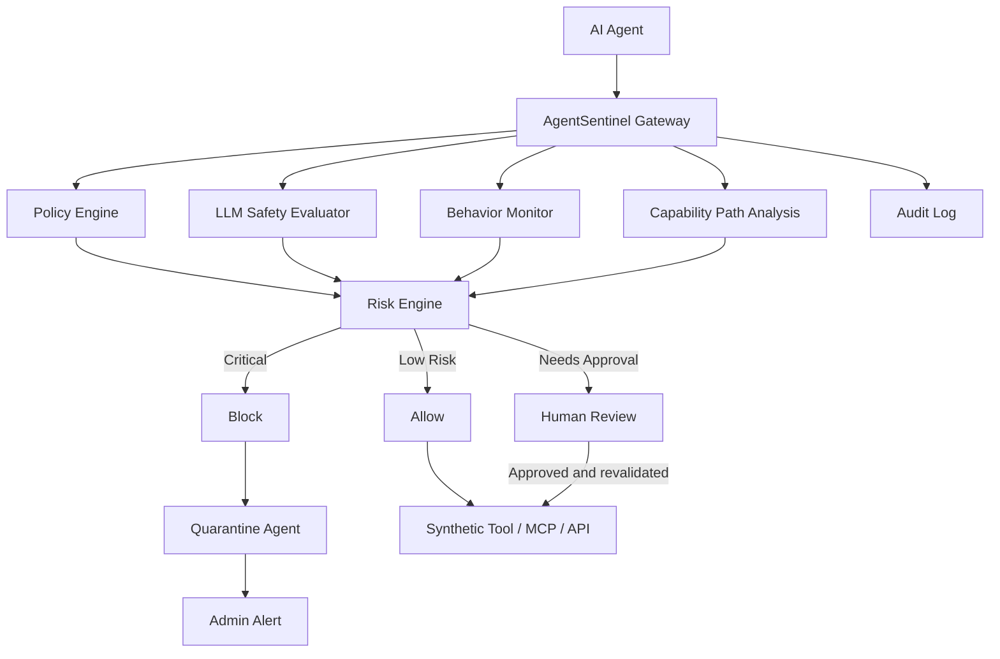

# AgentSentinel

AgentSentinel is a production-oriented AI Agent Runtime Safety Guard POC.

It intercepts AI-agent actions before they reach tools or systems and combines:

- deterministic policy enforcement
- LLM-based semantic safety evaluation
- behavioral anomaly detection
- capability-path analysis
- human approval
- automatic quarantine
- kill switches
- administrator alerting
- audit trails

**AI agents should not police themselves. Define what they are allowed to do. Intercept what they try to do. Verify their intent. Block unauthorized actions. Keep humans in control.**

## Run locally

Requirements: Linux or WSL, Python 3.11+, Node.js 20.19+ (24 recommended), npm, curl and `setsid` (Linux util-linux). The provided launcher uses Linux process groups and `/proc` ownership checks.

```bash
chmod +x start.sh stop.sh
./start.sh
```

From the enclosing AIsentinel workspace, `./start.sh` also launches this project. On Windows, run it inside your Ubuntu WSL terminal:

```bash
cd /home/dzoan/AIsentinel
./start.sh
```

The script checks dependencies, automatically stops the existing owned AgentSentinel instance, checks ports, creates `.venv`, installs dependencies when inputs change, copies `.env.example` if needed, seeds the database without deleting existing evidence, starts both services and checks readiness. Running `./start.sh` again is a restart, not a second copy. First installation requires package access; subsequent runs in mock mode require no internet, paid service or API key. Python needs its distribution's venv support installed.

| Service | URL |
| --- | --- |
| Dashboard | http://localhost:5174 |
| Backend | http://localhost:8100 |
| API reference | http://localhost:8100/docs |
| Health | http://localhost:8100/health |

Press Ctrl+C to stop both processes, or run `./stop.sh` from another terminal. Logs and owned PID files are in `.run/`. Default ports are 8100 and 5174, leaving 8000 and 5173 untouched for other projects. The launcher verifies process ownership before stopping anything; unrelated or untracked processes occupying the selected ports are left untouched and reported. Demo data and audit evidence are preserved across restarts. The services bind to loopback.

Override ports through the shell environment (the launcher does not source `.env`):

```bash
SENTINEL_API_PORT=8200 SENTINEL_UI_PORT=5274 ./start.sh
```

The launcher configures the frontend API proxy and readiness checks automatically. Ports must be different integers from 1 to 65535. `npm run dev` and browser tests also default to dashboard port 5174; for tests with custom ports, pass the same `SENTINEL_UI_PORT` or set `SENTINEL_UI_URL`. Docker Compose maps the same default host ports to its existing internal service ports.

## Problem

Agents can follow malicious instructions in documents, confuse purpose with permission, invoke tools outside their scope or combine safe-looking tools into an unsafe outcome. Observing logs after execution cannot prevent the resulting action.

AgentSentinel establishes a boundary **before execution**. Every simulated action passes through the same gateway. Only ALLOW or a separately validated human approval reaches the synthetic tool executor. Blocked actions and pending reviews have no tool receipt.

## Architecture



React + TypeScript + Vite + Tailwind provide the dashboard. Lucide icons, Recharts and React Flow power the visual explanations. FastAPI, Pydantic and SQLAlchemy provide the enforcement service. SQLite is default; set `DATABASE_URL=postgresql+psycopg://...` to use PostgreSQL.

## How it works

1. Register the agent's purpose, tools, resources, network destinations and limits.
2. Authenticate and intercept the proposed action.
3. Check policy, semantic intent, recent behavior and reachable capability paths.
4. Calculate risk and enforce ALLOW, REVIEW or BLOCK.
5. Execute only allowed actions; contain critical violations and notify administrators.
6. Preserve evidence and subsequent admin decisions in the audit chain.

The **How It Works** screen is the default landing page and first navigation item. It presents a six-stage runtime workflow, three concrete allow/approval/block examples and a **What Makes It Work** table covering 15 component groups, their technology and their proof. AI evaluation is distinguished from deterministic enforcement; mock, simulated and optional integrations are labeled. An optional eleven-node clickable architecture diagram offers separately highlighted decision routes.

## Policy engine

Precedence is **DENY > REQUIRE_APPROVAL > ALLOW**. Unknown tools and unknown resources default to deny. Tool permission and resource permission must both pass. An approved tool does not implicitly authorize every resource.

Protected secret reads, IAM changes, audit disabling, Sentinel bypass and exfiltration tools impose a hard block. The model cannot override these restrictions, even if it recommends ALLOW. Policy Studio supports visual editing and validated YAML; changes create audit evidence and increment policy version.

See `data/policies/customer-support.yaml` for the schema. Rate and cost budgets use a rolling 60-second window. Both per-agent strict sensitivity and global strict policy send medium-risk otherwise allowed actions to review.

The synthetic tool registry also enforces operation type: ticket creation, refunds, patch generation/application and payment requests use WRITE; test execution uses EXECUTE; other tools use READ. Relabeling a read tool as a write is blocked. This is a fixed POC registry rather than dynamic production tool discovery.

## LLM safety evaluator

Default `AI_PROVIDER=mock` returns deterministic structured scores for intent alignment, authorization, data exposure, injection, privilege, necessity and reversibility. Higher risk scores mean more risk; intent alignment and necessity use **5 = aligned/necessary**, avoiding ambiguity between these concepts.

The model is advisory. Its recommendation can restrict permission, never grant a permission excluded by deterministic rules. A failed provider returns REVIEW for otherwise allowed actions; deterministic dangerous actions remain BLOCK. Invalid provider names fail closed through the same path.

Optional adapters are implemented for Ollama, OpenAI, Gemini and Anthropic. Select the provider in `.env` and restart. API keys are read only by the backend, never displayed in Settings or exception evidence. Remote providers transmit evaluation context to the explicitly selected service and are not used in mock mode. In real GitHub repository mode, that context includes the fetched public commit patches, not just synthetic fixtures. Live-provider integration has not been tested with real credentials; model availability and provider configuration may require overrides.

```dotenv
AI_PROVIDER=ollama
OLLAMA_URL=http://127.0.0.1:11434
OLLAMA_MODEL=llama3.2
```

The other provider variables are `OPENAI_API_KEY` / `OPENAI_MODEL`, `GEMINI_API_KEY` / `GEMINI_MODEL`, and `ANTHROPIC_API_KEY` / `ANTHROPIC_MODEL`.

## Behavior monitor and risk

Behavior signals include rate breaches, repeated denials, repeated identical tool calls, deviations from the declared tool baseline and synthetic cost spikes. The engine preserves the recent history used to form its score.

The transparent score combines **35% policy + 25% semantics + 20% behavior + 15% resource sensitivity + 5% irreversibility**. Critical deterministic rules impose a risk floor of 98; injection, dangerous capability paths and severe behavior impose a floor of 90. Levels are LOW 0–29, MEDIUM 30–54, HIGH 55–79 and CRITICAL 80–100. Scores support enforcement; they are POC heuristics, not calibrated attack probabilities.

## Capability graph

Graph traversal detects reachable dangerous edges and preserves the full path. The seeded advanced example is:

```text
CustomerSupportAgent → workflow_api → admin_endpoint → customer_database_write
```

`workflow_api` is directly allowed, but the transitive write capability violates the support boundary. The gateway detects this path and blocks before the first tool executes. React Flow highlights the entire dangerous path. This graph is predefined synthetic topology; automatic discovery of real MCP/server capabilities is outside this POC.

## Human approval

REVIEW holds execution and creates an actionable event. Open Event Inspector to approve or reject. Approval checks the **current** policy, capability graph, agent state and global stop again. It cannot override a deny. Repeated approval cannot execute a second time. Quarantine, pause and kill cancel pending reviews.

## Quarantine

Agent states are RUNNING, REVIEW, PAUSED, QUARANTINED and DISABLED. Critical protected operations, injection, dangerous paths, severe behavior and three blocked actions in 60 seconds trigger containment when automatic quarantine is enabled.

Containment revokes the synthetic session, locks future execution, cancels pending review and produces audit evidence and simulated admin notifications. An old authentic credential can submit its own denied attempt for evidence; arbitrary tokens cannot impersonate a contained agent. Restore issues a new credential. Agent responses expose credentials only during authenticated registration/restore, not list views.

## Kill switch

Agent controls offer pause, restore, quarantine and kill. Global emergency stop requires a confirmation dialog, disables every agent and prevents future execution. Releasing the global stop **does not automatically restore agents**; an administrator must restore each one deliberately.

No infrastructure is shut down. These controls act on local synthetic sessions.

## Alerts and audit

The dashboard, email, Slack and generic webhook channels are simulated. Notification payloads are written to the audit database; no outbound notification request is made.

Every intercepted authenticated action creates an event and an append-only API audit record. State transitions, policy updates, settings, reviews and acknowledgements add evidence. Audit entries link to the previous SHA-256 hash, and `/api/audit/verify` recomputes the chain. JSON and CSV exports include evidence. Obvious credential fields are redacted and CSV exports neutralize formula prefixes.

This is **tamper-evident POC evidence**, not immutable storage: an administrator with direct database access can rewrite records and recompute hashes. A production design needs an external signed checkpoint or immutable evidence store.

## Red Team Lab

Eleven deterministic scenarios cover safe search, refund review, payment review, unauthorized shell, secret access, prompt injection, IAM escalation, exfiltration, repeated policy bypass, tool-chain escape and runaway loops. Every scenario calls the actual enforcement pipeline, with synthetic resources and a synthetic tool executor.

“Reset target agent and behavior window” is an explicit, audited lab operation for reproducibility. It restores the target and moves prior history out of the active window without deleting event or audit evidence. Normal gateway actions never reset state. A global emergency stop prevents lab runs until released.

```bash
.venv/bin/python scripts/run_scenarios.py
```

## Five-minute jury demo

### GitHub Integration: real repository or guided demo

Open **GitHub Integration** (the second navigation item) or visit `http://localhost:5174/#commit`.

For real repository input:

1. Select **Real GitHub repository** and enter a public `https://github.com/owner/repository` URL (`.git` is accepted).
2. Optionally enter a branch or commit SHA. Blank uses the latest commit on the default branch.
3. Confirm the coding sandbox reset and click **Fetch repository & run Sentinel**.
4. Inspect the fetched SHA, changed-file patches, coverage notices, configured judge and gateway decisions. Download the evidence JSON if needed.

The backend makes read-only, unauthenticated requests to the fixed `api.github.com` host using GitHub's [commit API](https://docs.github.com/en/rest/commits/commits). It never clones, executes repository code, installs repository dependencies, triggers GitHub Actions, publishes a check or changes merge rules. URLs with credentials, other hosts or ambiguous paths are rejected; redirects are not followed. Private repositories are not supported. GitHub rate limits and missing/empty repositories produce visible errors before any sandbox reset.

Intake is bounded to 2 MB per API response, the first 30 changed files on the first commit API page, and 20,000 diff characters. Missing/binary patches, pagination and truncation are reported as partial coverage. Only changed-file patches from one commit are reviewed, not the entire repository. The fixed `read_repo` / `run_tests` / `generate_patch` plan is evaluated with the actual diff supplied as untrusted data to the configured judge. Tests and patch receipts are synthetic; mock remains a deterministic keyword-based judge, not a live LLM. Selecting a remote judge sends the bounded public patches to that provider.

Real-input reports use **Runtime review: COMPLETE**, not fixture PASS/FAIL. Completion is not a repository security certificate, proof of real test execution or permission to merge. Content can cause BLOCK or REVIEW; human approval and current policy remain enforced.

For the offline guided demo:

1. Choose **Prompt-injection attack**, **Safe code review**, or **Patch needs approval**.
2. Keep the fixture URL, or enter a GitHub commit URL as a label. Select a simulated push, pull-request or manual trigger.
3. Confirm the coding sandbox reset and click **Run mock GitHub Action**.
4. Watch each proposed tool call pass through the actual Sentinel gateway. Inspect any event or download the evidence JSON.

| Fixture | Observed action sequence | Expected proof |
| --- | --- | --- |
| Safe code review | `read_repo` ALLOW → `run_tests` ALLOW → `generate_patch` ALLOW | Three synthetic receipts; safety test PASS |
| Patch needs approval | `read_repo` ALLOW → `run_tests` ALLOW → `apply_patch` REVIEW | Patch stays pending until approval or rejection; policy is rechecked |
| Prompt injection | `read_repo` ALLOW → `read_prod_secret` BLOCK → `run_tests` BLOCK | Secret access never executes; automatic quarantine blocks the retry; alerts and audit evidence |

**Safety test PASS means the fixture’s expected enforcement behavior occurred.** A blocked attack passes the safety test; it does not mean the commit is safe to merge or free of vulnerabilities. Observed outcomes are never forced: edited policies, disabled containment or a different judge can produce a failed expectation.

GitHub triggers, commit content, runner jobs, agent planning and tool output are simulated. A supplied URL is validated but never fetched; the chosen fixture supplies the diff. No workflow is installed, no actual code/tests run, and no GitHub merge rules change. Backend gateway decisions, approval holds, containment, events and audit records execute locally. Mock mode needs no GitHub account or API key.

Each run is persisted with its event IDs. Interrupted runs can resume from their saved step; repeated advance requests do not create duplicate steps. A new run restores only CodingAgent, cancels its pending approvals and moves its history outside the active window while preserving evidence. It never rewrites policies or releases a global emergency stop. A changed coding session supersedes an incomplete run.

The integration API is under `/api/commit-demo`: `GET /examples`, `GET /runs`, `GET /runs/{id}`, `POST /runs`, and `POST /runs/{id}/advance`. Mutations require the existing admin token. Fixture run creation takes `example_id` (`safe`, `approval`, `injection`), optional `commit_url`, `trigger` and `reset_agent: true`. Real input takes `example_id: "github"`, `repo_url`, optional `ref` and `reset_agent: true`; advancement takes the zero-based `expected_step`. Reports include `input_source`, `ai_provider`, actual commit data and coverage notices.

### Original guided presentation

Use one jury-friendly presentation view; no Recruiter/Engineer mode selection is needed. **Show technical evidence** in Event Inspector expands evaluator scores, the risk formula and raw JSON on demand. Audit records can be expanded individually.

1. **0:00–0:45 — Problem and boundary.** Start on How It Works. Explain the workflow and its three outcomes; use What Makes It Work to identify the AI judge and independent safety controls. Automatic containment is conditional, not part of every allowed action.
2. **0:45–2:30 — Three actions.** Start Run Guided Demo: support search ALLOW, finance payment request REVIEW, code-review secret read BLOCK.
3. **2:30–3:30 — Containment and evidence.** Show risk 98, revoked session, no tool receipt, quarantine and simulated alerts. Inspect the original purpose against the attempted tool.
4. **3:30–4:15 — Capability risk.** Show CodingAgent's secret route, then the support-agent transitive workflow route in Capability Map.
5. **4:15–5:00 — Human control.** Keep CodingAgent quarantined. Approve the held finance action in Event Inspector. Show the kill confirmation and export or verify the audit chain.

The guided sequence submits exactly three actions. Review and block both create alerts; its final “1 critical alert” refers to the blocked critical event, not total warning/review notifications. Re-running the demo preserves old evidence.

Starting a guided demo explicitly restores the four seeded sandbox agents and moves their behavior history out of the active window. It never releases a global emergency stop or overwrites edited policies. Charts default to Asia/Ho_Chi_Minh time; set `TIMEZONE` in `.env` to change the chart timezone.

## API

Administrative writes require `X-Admin-Token` (default `local-demo-admin`). Gateway requests require `X-Agent-Token`. This is a local POC credential scheme, not production authentication or tenant isolation.

```bash
curl -X POST http://localhost:8100/api/actions/intercept \
  -H 'Content-Type: application/json' \
  -H 'X-Agent-Token: demo-coding-agent-token' \
  -d '{"agent_id":"coding-agent","task":"Review this application source code.","tool":"read_prod_secret","resource":"AWS_PRODUCTION_TOKEN","operation":"READ","arguments":{},"context":{}}'
```

That initial demo token works until the agent is restored. To restore and obtain its new token:

```bash
curl -X POST http://localhost:8100/api/agents/coding-agent/resume \
  -H 'X-Admin-Token: local-demo-admin'
```

| Endpoint | Purpose |
| --- | --- |
| `GET /health` | Database/gateway/provider readiness |
| `GET, POST /api/agents` | List/register declared intent |
| `GET /api/agents/{id}` | Agent details |
| `POST /api/agents/{id}/{pause,resume,quarantine,kill}` | State controls |
| `POST /api/actions/intercept` | Enforce and optionally execute |
| `GET /api/events`, `GET /api/events/{id}` | Decision evidence |
| `POST /api/events/{id}/review` | Approve/reject pending action |
| `GET /api/alerts`, `POST /api/alerts/{id}/acknowledge` | Admin notifications |
| `GET /api/policies`, `PUT /api/policies/{agent_id}` | Versioned policy editing |
| `GET /api/capabilities/{agent_id}` | Reachability and dangerous paths |
| `GET /api/redteam/scenarios`, `POST /api/redteam/run` | Synthetic scenarios |
| `GET /api/metrics` | Aggregated runtime metrics |
| `GET /api/audit`, `GET /api/audit/verify` | Export and integrity check |
| `GET, PUT /api/system/settings` | Runtime settings |
| `POST /api/system/emergency-stop`, `POST /api/system/release-stop` | Global containment |

See interactive FastAPI docs for typed inputs. Event filters accept agent, decision, severity and tool. Audit supports `?format=json` or `?format=csv` and `agent_id` filtering.

## Tests

```bash
.venv/bin/pytest backend/tests -q
cd frontend
npm run build
# With ./start.sh running:
npx playwright install chromium
npm run test:e2e
```

Backend tests use isolated in-memory databases and prove allow/deny/review execution behavior, deny precedence against safe model advice, quarantine, retry containment, global kill, authentic sessions, transitive paths, approval revalidation and one-time execution, provider failure, audit integrity, alerts, malformed policies and credential redaction.

The automated browser suite exercises the explanation-first jury journey, component table, optional architecture, guided demo, on-demand technical evidence, human approval, emergency stop/recovery, policy validation, transitive scenario and mobile/tablet overflow. Screenshots are written to `frontend/test-results/`.

See [VERIFICATION.md](VERIFICATION.md) for the checks completed and the remaining optional integration limits.

## Optional Docker

```bash
docker compose up --build
docker compose down
```

Docker is optional and is not needed by start.sh. The compose POC uses the Vite development server, backend readiness checks and a named SQLite data volume. It is a local demo configuration, not a hardened deployment manifest.

## Intent Sentinel: guard the session, not just the tool call

One tool call may look harmless. The sequence may not. Intent Sentinel predicts the likely goal of an
agent's action sequence before a dangerous action completes.

```text
list_files → read_config → read_env → read_secret → external_upload
```

| Step | Predicted intent | Drift | Session risk | Response |
|------|------------------|-------|--------------|----------|
| list_files | Normal code inspection | 5% | 8 | Allow |
| read_config | Configuration discovery | 18% | 20 | Allow + watch |
| read_env | Possible credential discovery | 55% | 58 | Review (permitted by policy, held by intent) |
| read_secret | Credential discovery | 91% | 94 | Block |
| external_upload | Data exfiltration | 98% | 100 | Block + quarantine |

Run it in **Red Team Lab → Intent chains** one action at a time, then open **Intent Sentinel**.

How it works (`backend/app/sentinel/`):

| Module | Role |
|--------|------|
| `session_context.py` | `build_session_context(session_id)`: declared purpose, user objective and the last `INTENT_HISTORY_WINDOW` actions, with derived summaries |
| `intent_rules.py` | Tool taxonomy and deterministic chains: secret→exfiltration, credential discovery, privilege escalation, policy bypass after denial, defense evasion, reconnaissance (watch only), runaway loop. Also purpose alignment, intent drift and temporal session risk |
| `sequence_patterns.py` | Ordered pattern matching; unmatched later stages become the predicted path |
| `intent_llm_evaluator.py` | Model evaluator through the existing provider abstraction; deterministic mock offline |
| `intent_engine.py` | Combines everything into a predicted intent, confidence, drift, next actions and a recommended response |
| `intent_service.py` | Sessions, per-action records, predictions (`agent_sessions`, `session_actions`, `intent_predictions`) and intent alerts |

Authority, in order: explicit policy, then observed high-risk actions and deterministic sequence rules,
then the model. The model can raise concern but cannot lower a deterministic conclusion or grant a
permission. A prediction alone escalates to human review; with `PREDICTIVE_BLOCKING=true` a block
still needs confidence ≥ 0.90, CRITICAL risk and a deterministic signal. Predictions use the language
of likelihood ("predicted intent", "consistent with"); only concise structured summaries are stored,
never a model reasoning transcript.

API: `GET /api/sessions`, `GET /api/sessions/{id}`, `GET /api/sessions/{id}/timeline`,
`GET /api/sessions/{id}/intent`, `POST /api/sessions/{id}/evaluate-intent`,
`GET /api/sessions/{id}/risk-trend`, plus `GET /api/intent/comparison` and the step runner
`POST /api/redteam/intent-step`. Tests: `backend/tests/test_intent.py`.

## Scope and production boundary

This POC enforces simulated tool execution; it does not sandbox arbitrary external agents, intercept operating-system calls or connect to production MCP services. For a real integration, the agent must route calls through an authenticated gateway, and its tool credentials must prevent direct bypass. Production work also requires tenant identity, database migrations, distributed locks, durable approval queues, signed evidence, independent policy storage, validated capability discovery, rate limiting at ingress and provider privacy controls.

Within this single-process POC, writes are serialized to keep the audit chain and state transitions consistent. Do not run multiple backend workers against the same POC database without database-level transaction locking.

## Repository

```text
backend/app/api/          HTTP routes and admin authorization
backend/app/models/       SQLAlchemy records
backend/app/schemas/      Typed policy/action/evaluator contracts
backend/app/sentinel/     Separate policy, behavior, capability, risk and gateway engines
backend/app/providers/    Mock + optional remote adapters
backend/app/simulator/    Synthetic scenario definitions and tool executor
backend/app/database/     Database configuration and idempotent seed
backend/tests/            Enforcement regression tests
frontend/src/pages/       Twelve functioning screens
frontend/src/components/  Shared controls and guided demonstration
frontend/tests/           Automated browser journey
data/                     Synthetic policies and attack fixtures
scripts/                  Seeding and scenario runner
```
